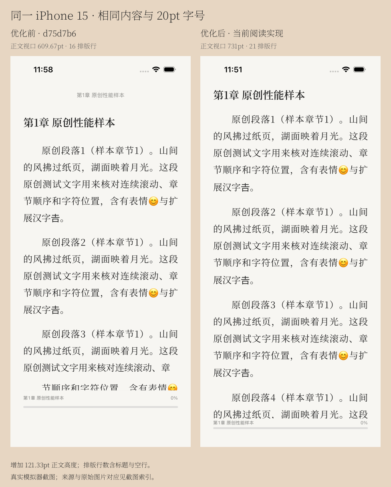
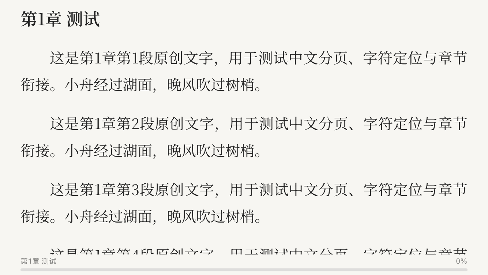
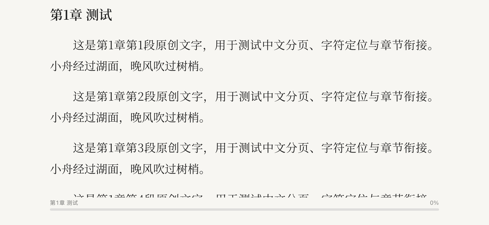
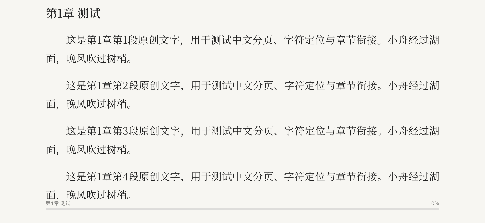

# 阅读布局、连续滚动与 Build 43 验证

2026-11-13 UTC：阅读修改已在标准 macOS GitHub Actions 编译为真实 unsigned arm64 Release IPA，并完成小屏、iPhone 15、大屏布局及同设备前后性能采样。仓库已实际 Public。真实 iPhone 的卡顿体验、Instruments 采样及同签名覆盖升级仍为 HUMAN_PENDING。

## 阅读布局

旧容器在隐藏工具栏后仍预留 52pt 顶栏、8pt 上边距及约 88pt 页脚。新阅读会话默认沉浸，仅保留 28pt 进度底栏；工具栏使用浮层，不改变正文容器、分页高度或滚动位置。正文按系统安全区布局，没有负 padding 或针对机型写死屏幕坐标。章标题前后段距为 8/16pt，纸边 8pt；正文字号、字重、左右边距、行距及段距保持原有设置语义。

同一 iPhone 15、相同原创内容和 20pt 字号，正文视口由 **393×609.67pt 增至 393×731pt**，增加 **121.33pt**。首屏可见排版行 16→21，其中包含标题与空行，不能等同于增加 5 行连续正文。

小屏、iPhone 15、iPhone 17 Pro Max 的四种 TXT 模式均验证竖屏沉浸、浮层工具栏与横屏。工具栏显隐前后严格比较正文 frame 和内容；跨章末页、字号/行距/主题重排、后台及重进的字符锚点有回归断言。横屏截图采用完整屏幕采集，等待视口和内容稳定后导出并人工检查；展示图仅旋转方向，未裁切正文，原图和对应测试保留在证据包。

## 连续滚动的根因与改动

旧路径在 MainActor 同步读取/解码章节并整章 CoreText 分页；UITextView 高度测量、配置及相邻章节 reload 会重复排版；滚动回调查询字形并频繁写入进度。固定 d75d7b6 基线加入相同 DEBUG 探针，实际捕捉到超长单章的主线程整章分页最大 645.32ms、长篇章节更新最大 236.22ms。原始路径分析见 [INVESTIGATION.md](INVESTIGATION.md)。

现在文件读取/解码由后台任务完成，串行 actor 准备约 1600 UTF-16 的文本块，尊重组合字符和 CRLF。TextKit 在后台完成字形布局后，UIKit canvas 直接绘制同一套已准备的 glyph，避免 UITextView 再次排版。表格使用固定行高、稳定 row ID 和缓存行锚点，保留原生惯性、回弹和减速；相邻章按有界窗口预加载，没有每帧 scrollTo、分页吸附或人为降低刷新率。

真实字形回归验证预排版和绘制高度 **5425→5425pt、1005→1005pt**，完整绘制 1597/297 UTF-16，检查位图末行及字符命中。滚动回调用缓存锚点二分和章节前缀和，不进行文件读取、整章分页或 TextKit 排版。字号/尺寸重排保留原始字符目标，实际用户拖动或导航后才解除；退出和后台保存最后有效锚点。

滚动时最多每 0.5 秒暂存位置；停止、后台、退出和书签时提交原有 ReadingPosition，重复 flush 不重复写 JSON。提交仍使用原有同步持久化方式，不能宣称所有主线程工作或写盘都已消除。

## 相同设备、内容与手势的实测

[校准 benchmark 43418894170](https://github.com/hdd290187-web/QingRead-iOS/actions/runs/43418894170)：同一 iPhone 15 / iOS 26.2 Simulator，基线 d75d7b6 与优化后 ef03a55，三种样本各执行相同 12 次向上快甩、4 次反向和慢拖，并验证退出重进的精确位置。两边各 3 通过 / 0 失败 / 0 跳过。比较脚本强制章节结构、UTF-16 长度、内容 SHA256 和模拟器 ID 一致。

| 原创样本 | 实际章节 / UTF-16 | 帧间隔 p95 ms 前→后 | 超过 1.5 倍预算的采样 前→后 | resident 峰值 MiB 前→后 |
| --- | --- | --- | --- | --- |
| short | 5 / 4,390 | 16.67 → 16.67 | 55/2043 (2.69%) → 8/2576 (0.31%) | 361.1 → 457.0 |
| long | 80 / 591,411 | 16.67 → 16.67 | 66/2481 (2.66%) → 7/2580 (0.27%) | 370.9 → 446.7 |
| monolith | 1 / 373,904 | 16.67 → 16.67 | 83/2471 (3.36%) → 3/2588 (0.12%) | 709.6 → 493.2 |

这里的长帧统计为活动滚动期间 CADisplayLink 回调间隔超过 1.5 倍显示预算的采样，**不是精确 GPU 掉帧率**。p95 均为 16.67ms，没有声称 p95 提升。长篇主线程章节更新最大 **236.223→0.592ms**；超长单章滚动回调最大 **16.833→1.330ms**。优化后的三组报告没有主线程文件读取、整章分页或滚动排版记录，滚动模式也没有整章分页操作。

内存存在取舍：短篇/长篇 resident 峰值分别增加约 **96/76MiB**，超长单章减少约 **216MiB**；保留已排字形和绘制缓存有成本。最长帧并非每组都下降：长篇 **79.01→81.97ms**。停滚后的长篇进度提交单次采样峰值 **75.17→102.35ms**。所有原始次数、p95、峰值、设备和样本内容哈希见 comparison.json。

short/long 是实际正常导入的 5/80 章。monolith 为 DEBUG 合成夹具中合并的 1 章、373904 UTF-16；生产 TXT 解析器原有 24000 UTF-16 存储分片保持原样。旧夹具可能把段落识别为章节，相关旧数据不进入本报告。录屏来自 simctl 的可变帧率采集，供核对动作与章节接续，不能从编码帧率推断显示掉帧。

这些值来自共享标准 Runner 上的 Simulator DEBUG 仪表采样，不能作为真实 iPhone 流畅度保证。设备 Time Profiler / Hangs / Core Animation、发热、惯性触感仍需真机验收。

## 编译、回归与证据来源

| 运行与来源 | 实际结果 | 说明 |
| --- | --- | --- |
| [完整运行 42](https://github.com/hdd290187-web/QingRead-iOS/actions/runs/43411473924)，e3710be | arm64 Release 通过；主计划 **62 通过 / 0 失败 / 3 跳过（65）**；iPhone 15 **10/0/0** | 主计划为 42 单元 + 20 UI 通过；3 项既有原生 Files 诊断跳过。大屏阶段超时导致整轮 cancelled、未打包，不能称该轮整体成功。 |
| 校准 benchmark，ef03a55 | 优化后 **3/0/0**；同设备基线 **3/0/0** | 仅接受通过结构与哈希校验的本轮数据。 |
| [Release 收尾运行](https://github.com/hdd290187-web/QingRead-iOS/actions/runs/43425216709)，ee08a79 | **success**；真实 arm64 Release、iPhone 17 Pro Max **2/0/0**；IPA 已生成 | 先严格验证上述原始证据与发布源码等价，再在新 Runner 上编译并完成大屏测试。 |

重复设备执行的用例不累加成更多独立用例。各源提交在 QingRead 目录下仅有合成 benchmark 夹具文件不同，该文件全部由 `#if DEBUG` 包裹，发布代码一致；validation-proof.json 保留校验结果。没有把超时的旧 IPA 或 Build 31 当作本次产物。

三项原生 Files 诊断是已有的 FileProvider 环境限制，未算作通过；选择回调后的 5 项实际复制/解析/入库 UI 测试和原生取消回归都通过。可用 import_only 单独诊断，不能用此模式交付 IPA。EPUB 正文、封面、字号主题、连续滚动和重进回归通过。

仅失败用例允许重试一次，原始日志/xcresult 留存；本次三组回归均无失败重试，真实计数见 [构建校验](../yuying/build-verification.json)。运行 42 大屏在第二用例停滞，未证明具体系统根因；收尾任务使用新 Runner、单个大屏目标和显式超时，未删除测试断言或更改阅读实现。

标准 GitHub 托管 **macos-15**，实际 macOS 15.8.2、Xcode 26.3 / 17C529、Swift 6.2.4、iPhoneOS / Simulator SDK 26.2。没有 larger 或 self-hosted Runner，没有新增依赖。Linux 只进行资源、语法和工作流检查，不冒充 UIKit 编译。

## 真实安装包与兼容性

- 版本 **1.0.0 Build 43**，arm64，unsigned，最低 iOS 17.0。
- 构建提交 `ee08a791ca570b09481c92d9a07314a6614f657c`；[实际构建](https://github.com/hdd290187-web/QingRead-iOS/actions/runs/43425216709)；[GitHub 发布](https://github.com/hdd290187-web/QingRead-iOS/releases/tag/v1.0.0-build43)。
- IPA SHA256：`c27da8248b7f20920b84e4a38de83a7d7c0cce5647aad52320d61468241c722e`；大小 23,437,264 bytes。
- 本地归档：`releases/QingRead-1.0.0-build43-run43425216709.ipa`。
- 下载后验证 ZIP、Mach-O arm64、Bundle/名称/版本、编译启动屏、字体/图标锁及无签名/描述文件；Release 不含 DEBUG 测试或合成样本启动入口。

Bundle ID 固定 com.hdd290187.qingread，Application Support/QingRead、书籍/章节 ID、library.json 格式、书签和设置键保持。导入及持久化 7 个关键文件与 d75d7b6 逐字节一致。予盈名称及最新可编辑 SVG 图标保留；ScreenTranslator-iOS 未修改。源码归档后续提交只同步工程、CI 和交付证据，App 构建提交始终单独记录。

仓库完整历史、全部可访问分支/tag、Actions 日志/产物及 Release 附件审计通过，素材来源由用户确认；[公开审计](../security/PUBLICATION_AUDIT.md)列明范围与增量复核，原始候选值及全系统模拟器诊断不进入交付。

**未签名 IPA 需要有效签名和设备授权。使用原有签名身份、Team 与 Bundle ID 覆盖安装，保留旧 App，不要先卸载或清除数据。** 同签名升级后的真实书库、进度、书签及真机连续滚动仍为 HUMAN_PENDING，步骤见 DEVICE_VALIDATION.md。
