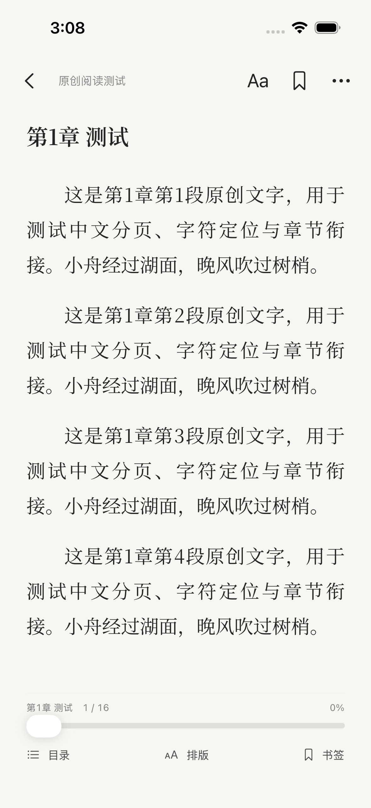

# 阅读布局与连续滚动候选改动

状态：源码、回归用例、采样与对照流程已实现；iOS 编译、XCTest、性能采样和新 IPA 尚未执行/生成。公开前审计仍有历史图片公开再分发权待确认，因此仓库保持 Private。本报告不宣称用户真机的滚动卡顿已验收修复。

## 布局根因与改动

旧 ReaderHost 即使隐藏工具栏，也保留 52pt 顶栏、8pt 正文上边距与约 88pt 页脚，标题段落另加前后距。新布局默认沉浸，正文直接使用安全区中的空间，只保留 28pt 轻量章节/进度底栏；上下工具改为浮层，出现/消失不改变正文容器或分页尺寸。未使用负 padding 或某台手机的绝对坐标。

纯布局预算归还约 120pt 给正文（旧 52+8+88 与新 28 的差），另把章标题前/后距从 12/24pt 调为 8/16pt；正文自身字号、字重、行距、段距、左右边距和用户既有偏好不缩减。实际增加多少可见行需要按设备/字体的真实排版记录，未用预算冒充截图或实测。CoreText 和滚动容器的 8pt 纸边配合安全区，使标题接近顶部，并保留 Home Indicator 空间。

优化前真实截图来自已验证 Build 31：

优化后截图尚未生成。ReaderLayoutTests 已准备小屏、iPhone 15、大屏与横屏的沉浸/浮层/跨章/字号/后台恢复场景；成功运行后，原始截图会分别保存在 Tests、Brand-iPhone15 与 Reader-Large 的 xcresult 附件中。

## 源码确认的滚动开销与候选修复

| 旧执行路径 | 候选改动 |
| --- | --- |
| MainActor 中同步读章节与 UTF-8 解码，再整章 CoreText 分页 | 文件读取/解码在后台 Task，排版在串行后台 actor；滚动模式直接预排版有界文本块，不再先整章分页 |
| 每个 cell 使用自动高度并在主线程反复布局 | 约 1600 UTF-16 的分块，保持组合字符/CRLF 边界；后台 TextKit 计算固定高度与行锚点，只创建可见 UITextView |
| 相邻章节到达后 reloadData、强制布局、scrollToRow | 按稳定行 ID 插入/删除，追加内容不调整视口；只在视口前插入/裁剪时做一次锚点补偿，保持有限相邻章节窗口 |
| 每个滚动回调 ensureLayout、字形查询、全部章节 reduce | 使用预计算行位置二分查找和章节前缀和；回调只记录内存中的 UTF-16 位置 |
| 每秒 Published 更新整个书架并同步写 library.json | 滚动中最多每 0.5 秒更新阅读页本身；停滚、后台、退出、书签时提交，重复 flush 不重复落盘 |
| 主题/亮度/点击区变更也可能重建整个表格 | 不影响排版的设置更新保留表格、滚动偏移和既有高度；主题只更新可见文字与背景 |
| 每次分页绘制从整章重新建 framesetter | 后台生成的不可变 framesetter 随 TextLayout 缓存复用 |

上述是可从源码确认的主线程路径和重复工作，详见 INVESTIGATION.md。尚无本次真实设备的时间采样，因此将它们写作已确认的开销来源与候选修复，不把源码推断写成真机帧率证据。UITableView 的原生惯性、减速与回弹保持，不改分页吸附、不降低刷新率、不做每帧 scrollTo。

## 同设备前后测量流程

新增 DEBUG-only os_signpost 和 CADisplayLink 采样：只记录固定操作名、耗时、活动滚动帧、超过 1.5 帧预算的数量和进程 resident memory，不记录书名、正文、文件路径或用户标识。

工作流仍用标准 macos-15。优化后在 iPhone 15 跑 short / long / monolith 三种原创样本，相同的 12 次快甩、4 次反向和慢拖；随后从固定 d75d7b6 建临时工作树，只加入同一套探针、样本和触摸测试，保持旧阅读行为，再在同一模拟器运行。两版录屏、单项工作峰值、帧时间与内存将由 export-reader-performance.py / compare-reader-performance.py 导出。基线补丁已本地应用校验，未靠代码开关在正式引擎中保留另一套逻辑。

**当前结果为 NOT_RUN，before/after 均为 null。** 尚无帧 p95、掉帧率、主线程峰值或内存前后数值，也没有优化后录屏。共享模拟器的采样即使通过，也不能代替真实 iPhone 的 Time Profiler / Hangs / Core Animation 验证。

## 本地已执行检查与未执行验证

- 47 个 Swift 文件经 Swift 6.2.3 Linux 编译器在 Release 与 DEBUG 条件下语法解析通过；这不包含 iOS SDK 类型检查或 Xcode 编译。
- Xcode 工程经 OpenStep 解析并核对源文件：32 App、8 单元测试、7 UI 测试文件全部引用；project.yml 为 CI 重新生成工程的输入。
- plist、字体/图标哈希、依赖与许可锁、EPUB fixture、Python 编译、shell/工作区空白检查通过。
- 新增 5 项 XCTest：组合字符/CRLF 完整、后台布局/不分页、固定行高与字符锚点、进度暂存/幂等 flush、后台读取/缓存。另新增 5 项 UI 用例，覆盖四模式布局、横屏、跨章字号后台恢复和三类滚动压力。原有导入、品牌与四模式回归仍保留。
- **本次 XCTest、真实 macOS arm64 Release、三尺寸模拟器和前后采样均未运行，不能套用 Build 31 的通过数量。**

## 数据与兼容

Bundle ID、Application Support/QingRead、书籍/章节 ID、library.json 格式及书签/设置键不变。LibraryStore、文件选择、协调暂存、导入事务、解析和错误反馈保持原实现。新增前缀索引、行布局和内存位置均为临时状态；持久化仍写原有 ReadingPosition。亮度、目录、书签、在线书源、EPUB 与四种 TXT 模式保留；最新矢量图标和“予盈”品牌不变。无用户书籍被上传、删除、清空或迁移；DEBUG 测试重置仅作用于 CI 合成测试沙盒。

## 发布与构建状态

[公开审计](../security/PUBLICATION_AUDIT.md) 凭据部分未发现真实秘密，但历史参考图片的公开再分发权仍待确认，结论为未通过公开条件。未执行 Public 修改，也未反复触发已知计费阻塞的任务；最近实际 Actions 仍为 [Build 32](https://github.com/hdd290187-web/QingRead-iOS/actions/runs/43357914231)，在任务开始前因 GitHub 付款/支出上限被拒绝。标准公开 Runner 不保证解除账户锁定。

可用旧 IPA 仍是已验证 Build 31，SHA256：5e6358f23ea8715eb5d2010c0797a4f9ad2ea4db6cb6cd55661ed5c5452289b6；它不含本次候选优化，也不含后续矢量新图标。没有把旧 IPA 重新命名为新包。通过安全条件、真实构建与回归后才能生成并交付本次 IPA。

源码已备份，后续提交以 [skip ci] 避免重复失败运行。恢复条件满足后，先由管理员按已授权范围改为 Public 并核对 API，再完整 dispatch build-ios.yml（不使用 import_only）。同签名升级及真机卡顿复测仍为 HUMAN_PENDING，覆盖时不要先卸载旧 App。
