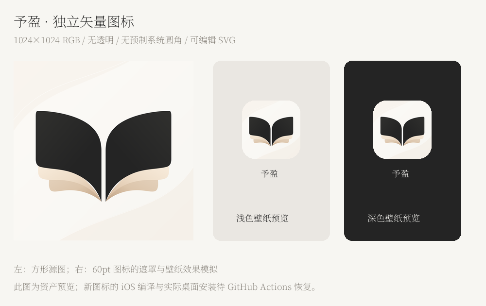

# 予盈：可编辑矢量图标与界面交付状态

最新文字说明要求独立重绘可编辑图标。该项源码和资产已完成；**新图标候选 Build 32 因 GitHub 账户计费/支出上限被拒绝启动，尚未进入编译，也没有生成 Build 32 IPA。** 当前实际通过 macOS/Xcode 构建与测试的可用包是 Build 31，包含已完成的品牌界面与先前提供的 PNG 图标。

## 已完成的视觉修改

- 桌面和 App 品牌统一为“予盈”，副标题“赠予盈盈的阅读时光”；暖白、香槟米、墨黑统一 Theme，宋体标题和原生导航。
- 启动页、默认双列书架、封面与已读进度、空书架、书架搜索/排序/列表、阅读工具栏、分组阅读设置、深色外观、书架/发现/我的均已实现为真实 SwiftUI/UIKit 页面。
- 阅读页收紧空白行留白，保持全部 UTF-16 字符；EPUB 使用 Readium 公开接口应用真实的章标题尺寸、边距和排版设置，并已通过渲染尺寸与重排检查。
- 最新图标为独立 SVG 贝塞尔重绘，具有暖白纸张底、墨黑对称书页及两层米色纸页。1024×1024 RGB PNG 无 alpha、无文字、无截图残留、无预烘焙圆角；启动页标志使用同一组路径。

可编辑源稿：`design/yuying-vector/AppIcon.svg`、`BrandSymbol.svg`；渲染脚本：`scripts/render-brand-assets.py`；颜色、尺寸、来源和 SHA256：`design/yuying-vector/asset-lock.json`。已按 CairoSVG 2.8.2 以 4 倍分辨率渲染并高质量缩小，重复渲染结果一致。该工具只用于开发，不增加 iOS 依赖。



上图为资产及遮罩模拟预览，新图标尚未在 iOS 编译或实际安装。

## 保留的功能与数据

Build 24 的文件选择、协调复制、事务导入、去重及错误反馈逻辑保持；UTF-8/UTF-16/GB18030/GBK TXT、EPUB、在线书源、四种 TXT 阅读方式、书签、目录、亮度和进度恢复均保留。图标更新未改动这些 Swift 代码。EPUB 的覆盖/卷曲继续使用滑动替代。

Bundle ID 仍为 `com.hdd290187.qingread`，Application Support/QingRead、书籍/章节 ID、library.json、进度/书签/设置键保持兼容。字体、LICENSE/NOTICE 和固定依赖保留。ScreenTranslator-iOS 未修改。

## 已实际通过的构建与测试：Build 31

- 成功 Actions：[43355596782](https://github.com/hdd290187-web/QingRead-iOS/actions/runs/43355596782)。构建提交 `8bb6d683702d35907f9826a0d3558d995fef101d`。
- macOS 15.8.2、Xcode 26.3 / 17C529、iPhoneOS SDK 26.2，generic/platform=iOS、arm64 Release，BUILD SUCCEEDED。
- iPhone SE 3 / iOS 26.2：37 项单元/集成 + 15 项 UI 通过，0 失败；3 项既有原生 Files 诊断明确跳过/HUMAN_PENDING。
- iPhone 15 / iOS 26.2：品牌 UI 另 5/5 通过，包含实际 EPUB 标题尺寸和字体主题重排；这些是第二设备重复执行的用例。
- 导入回调后的实际复制、解析、入库、错误反馈和重启读取参与必跑回归；不将其冒充系统 FileProvider 全链路验收。
- Build 31 的旧版 JSON 快照、ID/书签/位置/设置保留、封面缓存、四种阅读方式、取消回弹与重启均通过验证。
- IPA：`releases/QingRead-1.0.0-build31-run43355596782.ipa`，23,981,086 bytes。
- SHA256：`5e6358f23ea8715eb5d2010c0797a4f9ad2ea4db6cb6cd55661ed5c5452289b6`。
- ZIP、arm64 Mach-O、名称/Bundle ID、静态 LaunchScreen、字体哈希、无签名和不含 DEBUG 入口均已校验。

Build 31 的完整历史报告见 [BUILD31_REPORT.md](history/BUILD31_REPORT.md)，原始汇总见 test-summary.json 与 brand-iphone15-summary.json，完整日志和 xcresult 在 releases/run43355596782/。**这些通过结果属于 Build 31，不能用来宣称新的矢量图标包已经编译或测试通过。**

## Build 32 的实际阻塞及恢复

[run 43357914231](https://github.com/hdd290187-web/QingRead-iOS/actions/runs/43357914231) 在 2026-11-13 启动时失败，steps 为空，未执行 checkout、Xcode、测试或打包。GitHub 检查注释原文：

> The job was not started because recent account payments have failed or your spending limit needs to be increased. Please check the 'Billing & plans' section in your settings.

这是 GitHub 账户运行额度/计费的外部阻塞，未通过降低测试、改公开仓库或修改签名来绕过。候选源码提交 `796522270a69acf614356c47ad484e5bf1d0f102`；最新源码额外包含交付文档与预览图，App 资源与该候选提交一致。详细机器可读状态见 vector-build-status.json。

账户恢复后可直接重跑：

```bash
gh run rerun 43357914231 --repo hdd290187-web/QingRead-iOS
```

仍使用原有 macOS 工作流，完整执行 Release、主回归、iPhone 15 回归及打包；不能把本机 Linux 资源检查写成 Xcode 构建通过。

## 文件与覆盖安装

最新完整源码归档包含可编辑 SVG、RGB PNG、原生页面、生成工程、测试、报告、素材许可与渲染脚本。另附可用 Build 31 基线 unsigned ZIP，名称明确含 baseline，其 IPA 仍是先前 PNG 图标；不是尚未生成的 Build 32。

使用原有有效签名身份、Team 与 Bundle ID 覆盖 Build 24，不要先卸载、清除数据或改随机 Bundle ID。unsigned IPA 需要有效签名与设备授权。详细步骤见 [安装说明](../INSTALL.md)。

## HUMAN_PENDING

GitHub 账户恢复后，新矢量图标仍需完成真实 macOS 构建、两设备回归、IPA 校验和桌面图标截图。新版本的同签名覆盖数据保留、原文件提供器导入、真实 iPhone 翻页跟手/短拖回弹、亮度、安全区、壁纸效果及长时间阅读发热仍需真机确认，见 [具体复测](DEVICE_RETEST.md)。
